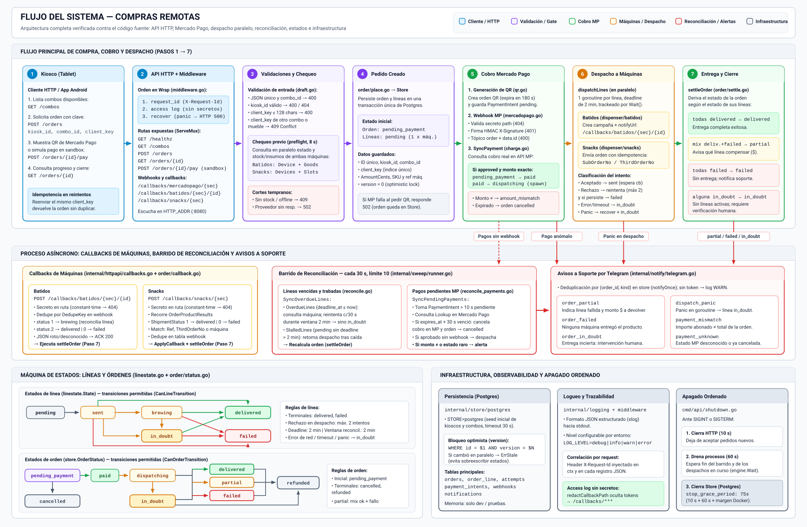

# Arquitectura del proyecto

Backend de combos para un mueble con dos máquinas expendedoras independientes (batidos y snacks) y una tablet central. La aplicación Android de la tablet vive en un repositorio aparte (`../compras-remotas-app`).

Este documento describe cómo funciona el sistema por dentro (paquetes, dependencias, invariantes y flujo paso a paso con referencias `archivo:línea`). Para instalar, configurar y ejecutar la aplicación, consulta [README.md](../README.md); para el cobro con Mercado Pago, [diseno-mercadopago.md](diseno-mercadopago.md); para lo que queda abierto, [pendientes.md](pendientes.md); y para explicaciones símbolo por símbolo, [comentarios-codigo.md](comentarios-codigo.md).



---

# PARTE 1: Visión general

## Regla de oro antes de leer código

**El código no lleva comentarios, a propósito.** Toda la explicación —qué hace cada símbolo y por qué se decidió así— vive en [comentarios-codigo.md](comentarios-codigo.md), indexado por archivo y símbolo. Este documento te dice **dónde** mirar; ese otro te dice **por qué**.

## Tests: dónde viven y cómo se usan

`main` no contiene ningún `*_test.go`. Los 59 archivos de tests viven en la rama `archive/tests`, que se sube a `origin` junto con `main`:

```bash
# traer los tests antes de trabajar sobre comportamiento
git checkout archive/tests -- $(git ls-tree -r --name-only archive/tests | grep '_test.go$')

# limpiarlos antes de commitear en main (main no recibe tests)
git rm -q -f $(git ls-files '*_test.go')
```

- **Flujo**: traer los tests desde `archive/tests`, escribir primero el test del cambio, correr la suite (nota: `go test ./... -race` no corre en Windows sin compilador C para cgo), limpiarlos en `main` con `git rm -q -f` y commitear los tests en `archive/tests`.
- **Costo**: mientras los tests vivan sólo en `archive/tests`, `main` no tiene red de regresión directa ni CI automática sobre los cambios de la app.

## Mapa de paquetes

| Paquete | Responsabilidad | Símbolos principales |
| --- | --- | --- |
| `cmd/api` | Composition root: único paquete que conoce proveedores y dominio a la vez | `main`, `newServer`, `openStore`, `shutdown` |
| `cmd/fakeapi` | Levanta los sustitutos locales (Batidos, Snacks, Mercado Pago) y admin loopback | `main`, `requireLoopback` |
| `migrations` | Los 7 `.sql` del esquema embebidos en el binario (`//go:embed`) | `Files` |
| `cmd/migrate` | Aplica las migraciones pendientes y termina | `main`, `run` |
| `internal/migrate` | Detecta pendientes y verifica checksums SHA-256 bajo advisory lock | `Apply`, `versions`, `checksum`, `missing`, `applyOne` |
| `internal/machine` | **Vocabulario compartido**: familia y referencia de máquina | `Kind`, `Batidos`, `Snacks`, `Ref` |
| `internal/linestate` | **Vocabulario compartido**: estado de una línea de despacho | `State`, `Pending`, `Sent`, `Brewing`, `Delivered`, `Failed`, `InDoubt` |
| `internal/config` | Topología desde JSON + overrides de entorno + validación al arranque | `Load`, `Config`, `Kiosk` (con `MPPosID`), `Machine`, `validate`, `MercadoPagoEnabled`, `TelegramEnabled` |
| `internal/catalog` | Menú: carga, valida sumas de ítems y sirve combos activos | `Combo`, `Item`, `LoadFile`, `Memory` |
| `internal/dispenser` | **Puerto** hacia las máquinas, sin saber de proveedores (`Check` es código legado en desuso tras `preflight`) | `Dispenser`, `Request`, `DispatchResult`, `Status`, `Rejection` |
| `internal/dispenser/batidos` | Adaptador GS: firma MD5, campaña, canje, `getOrderInfo` | `Client`, `Dispenser`, `CampaignTime` |
| `internal/dispenser/snacks` | Adaptador OurVend/YS: HMAC-SHA256, nonce, despacho remoto, consulta | `Client`, `Dispenser`, `PageQuery` |
| `internal/store` | **Puerto** de persistencia (16 métodos) + implementación en memoria | `Store`, `Order`, `Line`, `Attempt`, `Webhook`, `PaymentIntent`, `OrderStatus`, `PaymentStatus`, `AttemptOutcome`, `ErrStale`, `ErrInvalid`, `Memory` |
| `internal/store/postgres` | Implementación sobre PostgreSQL con *optimistic locking* y sembrado | `Open`, `Store`, `Seed` |
| `internal/topology` | Upsert de muebles, máquinas y combos al arrancar | `Seed` |
| `internal/order` | **El dominio**: crear, cobrar, despachar, reconciliar, asentar y avisar | `Engine`, `Draft`, `CreateOrder`, `RequestQR`, `SyncPayment`, `SyncPendingPayments`, `MarkPaid`, `SyncOverdueLines`, `ApplyCallback`, `SyncLineFromCallback`, `AvailabilityChecker`, `NotSellableError`, `DeriveOrderStatus` |
| `internal/gate` | Adaptador `order.AvailabilityChecker` sobre `preflight` | `New`, `Check` |
| `internal/preflight` | Regla de disponibilidad previa (consulta ambas máquinas en paralelo) | `Checker`, `Request`, `Result`, `Reason` |
| `internal/httpapi` | Borde HTTP (tablet, callbacks de máquinas, webhook MP) y middleware (`Wrap`) | `Handler`, `Callbacks`, `MercadoPagoWebhook`, `Deps`, `BatidosCallbackURL`, `Wrap` |
| `internal/payments` | **Puerto** de cobro (`Gateway`). También define `Refunder` y `MockRefunder` (fuera del MVP, sin conectar) | `Gateway`, `Charge`, `ChargeStatus`, `QRRequest`, `Refunder`, `MockRefunder` |
| `internal/payments/mercadopago` | Adaptador Orders API de Mercado Pago (`net/http`, sin SDK) y verificación de firma | `Client`, `VerifySignature`, `SignatureHeader` |
| `internal/notify` | Puerto de avisos a soporte + transportes por log y Telegram | `Notifier`, `Kind`, `Event`, `LogNotifier`, `TelegramNotifier` |
| `internal/sweep` | Barrido periódico: dispara `SyncOverdueLines` y, con MP, `SyncPendingPayments` | `Runner`, `New`, `WithPaymentSync` |
| `internal/logging` | Logger JSON (`slog`) con capitalización, `LOG_LEVEL` y `request_id` en contexto | `New`, `NewFromEnv`, `ParseLevel`, `WithRequestID`, `Capitalize` |
| `internal/fakeapi` | Proveedores simulados locales + superficie de administración | `NewBatidos`, `NewSnacks`, `NewMercadoPago`, `NewAdmin` |

## Dirección de las dependencias

Todas las flechas apuntan **hacia adentro**. Los puertos no conocen adaptadores:

```text
cmd/api ──► httpapi ──► order ──► store (puerto) · dispenser (puerto) · payments (puerto) · machine · linestate · notify
                │           │                ▲            ▲                    ▲
                │           └──► gate ──► preflight      │                    │
                └──► catalog, config          batidos ───┘   payments/mercadopago
                                              snacks ────┘
store/postgres ──► store (tipos) · topology · machine · linestate
```

Reglas estructurales:

- `order` **no** importa `batidos`, `snacks`, `payments/mercadopago`, `httpapi` ni `config`. Sí importa el puerto `payments`.
- `catalog` no importa `dispenser`.
- `machine` y `linestate` no importan ningún paquete interno del proyecto: son vocabulario puro.
- `store` **no** importa `dispenser`: guarda la referencia como `machine.Ref` y el estado como `linestate.State`.

## Invariantes

1. **El precio y el SKU salen del catálogo**, nunca del cliente. El body de `POST /orders` sólo acepta `combo_id`, `client_key` y `kiosk_id`. Cada ítem de catálogo lleva `price_cents > 0` y su suma debe coincidir con el `price_cents` del combo (`internal/catalog/catalog.go:91-99`).
2. **Idempotencia de creación por `client_key`**: la consulta por `client_key` es la vía rápida y la restricción única en `store` es la verdad definitiva. Contrato del kiosco: un UUID por pedido confirmado, reutilizado sólo para reintentarlo (`<= 128` runas tras `TrimSpace`, si excede responde `400`; mismo combo y mueble devuelve `200` con la orden existente; otro combo u otro mueble registra `warn` y responde `409`, sin crear ni alterar órdenes).
3. **Cada línea pertenece a una sola familia de máquina** (`line.Machine.Kind`). El nombre `MachineType` se mantiene legítimamente en `internal/order/callback.go:33`, `internal/catalog/catalog.go:17` e `internal/httpapi/responses.go:49`.
4. **El estado de la orden se deriva de sus líneas** (`DeriveOrderStatus`), nunca se inventa; `settleOrder` lo recalcula tras cualquier cambio de línea.
5. **Una línea cerrada es terminal**: `delivered` y `failed` nunca se reabren.
6. **Concurrencia optimista por versión**: `SaveOrder`, `SaveLine` y `SavePaymentIntent` son escrituras condicionales y devuelven `ErrStale` ante versión vieja.
7. **El dedupe se registra después del efecto durable**, para que un fallo transitorio no queme la clave. Excepción: callbacks que nunca podrán aplicarse (`ErrCallbackUnknownLine`, `ErrCallbackAmbiguous`, `store.ErrNotFound`) se registran antes para evitar reintentos infinitos.
8. **Reintento sólo ante rechazo de negocio claro**: HTTP 4xx (salvo `408` y `429`) con sobre y `code` del proveedor, o HTTP 200 con código de error de negocio, devuelven `*dispenser.Rejection` y se reintentan (salvo en el paso 2 de batidos: tras emitir el código de canje, cualquier fallo en `ProduceCoffee` pasa a `in_doubt` con ese código y nunca crea una segunda campaña). Cualquier 5xx, 429, 408, timeout, error de red o respuesta ilegible/sin `code` pasa a `in_doubt` para reconciliación.
9. **El callback de batidos no cierra la línea por sí solo**: no trae firma del proveedor, por lo que consulta `getOrderInfo` antes de cerrar.
10. **Los secretos de callback viajan en la ruta** y se comparan en tiempo constante (`subtle.ConstantTimeCompare`); sin secreto configurado o ante discrepancia responden `404`. Las rutas `/callbacks/...` se redactan en los logs como `/callbacks/***`.
11. **El pago simulado sólo existe en `sandbox` y sin Mercado Pago**: `POST /orders/{id}/pay` responde `403` en `production` o cuando Mercado Pago está activo.
12. **Si el pago quedó registrado y el despacho falló, `POST /orders/{id}/pay` responde `200` con el estado real** (`internal/httpapi/orders.go:94-106`), nunca `5xx` que invite a pagar dos veces.
13. **Manda Mercado Pago, no nuestro reloj**: nunca se cancela una orden por cuenta propia; al vencer el QR se solicita la cancelación a Mercado Pago y se obedece su respuesta.
14. **El webhook de Mercado Pago no confía en el cuerpo**: valida la firma `X-Signature` (HMAC-SHA256) y consulta `GET /v1/orders/{id}` (`Lookup`).
15. **Un monto pagado distinto al del catálogo no se despacha**: la orden queda en `pending_payment`, el intento de pago en `amount_mismatch` y se avisa a soporte (`payment_mismatch`).

## Vocabularios

| Tipo | Paquete | Valores |
| --- | --- | --- |
| `machine.Kind` | `internal/machine` | `batidos`, `snacks` |
| `linestate.State` | `internal/linestate` | `pending`, `sent`, `brewing`, `delivered`, `failed`, `in_doubt` |
| `store.OrderStatus` | `internal/store` | `pending_payment`, `paid`, `dispatching`, `delivered`, `partial`, `failed`, `in_doubt`, `refunded`, `cancelled` |
| `store.AttemptOutcome` | `internal/store` | `ambiguous`, `accepted`, `rejected`, `error` |
| `store.PaymentStatus` | `internal/store` | `pending`, `approved`, `expired`, `cancelled`, `amount_mismatch` |
| `payments.ChargeStatus` | `internal/payments` | `pending`, `approved`, `expired`, `cancelled`, `unknown` |
| `notify.Kind` | `internal/notify` | `order_in_doubt`, `order_failed`, `order_partial`, `dispatch_panic`, `payment_mismatch`, `payment_unknown` |
| `preflight.Reason` | `internal/preflight` | `batidos_device_offline`, `batidos_device_faulted`, `batidos_out_of_supplies`, `batidos_sku_not_listed`, `batidos_sku_sold_out`, `snacks_device_not_found`, `snacks_device_offline`, `snacks_sale_not_allowed`, `snacks_device_faulted`, `snacks_device_locked`, `snacks_device_out_of_stock`, `snacks_sku_not_in_any_slot`, `snacks_sku_out_of_stock`, `snacks_slot_not_sellable` |

## Glosario de verbos

| Verbo | Significado | Ejemplos |
| --- | --- | --- |
| **Create** | Crea una entidad nueva | `CreateOrder` |
| **Mark** | Cambia estado propio sin consultar al proveedor | `MarkPaid` |
| **Apply** | Aplica un aviso tal cual porque es la verdad autoritativa | `ApplyCallback` (snacks) |
| **Sync** | Consulta al proveedor y aplica el estado obtenido | `SyncPayment`, `SyncLineFromCallback`, `SyncOverdueLines`, `SyncPendingPayments` |
| **Barrido** | Worker periódico (`sweep.Runner`) que ejecuta los `Sync…` | `sweep.WithPaymentSync` |

«Overdue» significa **plazo vencido** (`deadline_at <= now`), no «en duda» (`in_doubt`). Las interfaces de borde usan rol agente: `OrderCreator`, `PaidMarker`, `QRRequester`, `PaymentSyncer`, `CallbackHandler`, `AvailabilityChecker`.

## Constantes internas (no configurables por JSON/env)

| Constante | Valor | Ubicación |
| --- | --- | --- |
| Plazo por línea (`defaultLineDeadline`) | 2 min | `internal/order/reconcile.go:14` |
| Ventana de reconciliación (`defaultReconcileWindow`) | 2 min | `internal/order/reconcile.go:16` |
| Intervalo de reconciliación (`defaultReconcileInterval`) | 30 s | `internal/order/reconcile.go:18` |
| Intentos máximos por línea (`defaultMaxAttempts`) | 2 | `internal/order/dispatch.go:15` |
| Barrido periódico (`sweepInterval`, `sweepLimit`) | Cada 30 s, lote de 10 líneas y 10 pagos | `cmd/api/main.go:34-35`, `internal/sweep/runner.go:11-12` |
| Vencimiento del QR (`defaultQRExpiry`) | 180 s | `internal/order/qr.go:13` |
| Antigüedad mínima de QR para barrido (`paymentReconcileAge`) | 10 s | `internal/order/reconcile_payments.go:13` |
| Margen tras vencimiento antes de cancelar (`paymentCancelGrace`) | 30 s | `internal/order/reconcile_payments.go:15` |
| Tolerancia de firma del webhook MP (`SignatureTolerance`) | 5 min | `internal/payments/mercadopago/signature.go:14` |
| `ReadHeaderTimeout` / `ReadTimeout` | 5 s / 10 s | `cmd/api/server.go:11-12` |
| `WriteTimeout` / `IdleTimeout` | 60 s / 60 s | `cmd/api/server.go:13-14` |
| `MaxHeaderBytes` | 64 KB | `cmd/api/server.go:15` |
| `httpShutdownTimeout` / `drainTimeout` | 10 s / 60 s | `cmd/api/shutdown.go:11-12` |
| Cuerpo máximo HTTP (`maxBodyBytes`) | 64 KB | `internal/httpapi/respond.go:8` |
| Presupuesto del chequeo previo (`checkBudget`) | 8 s | `internal/preflight/checker.go:19` |

### Mecanismo de apagado ordenado

Ante `SIGINT` o `SIGTERM`, `cmd/api/shutdown.go:25` ejecuta en orden:

1. `server.Shutdown` con `10 s` de margen (`httpShutdownTimeout`).
2. Espera a que termine la vuelta activa del barrido (`sweepDone`) y luego llama a `engine.Wait` (`internal/order/engine.go:190`, que marca `closed = true` para que `spawn` no lance despachos nuevos y espera `inFlight`), todo dentro de un presupuesto compartido de `60 s` (`drainTimeout`).
3. Cierra Postgres (`closeStore`) al final. Si vence el drenaje, registra el trabajo pendiente en `ERROR` para que el barrido lo retome al reiniciar.

## Convenciones

- **Identificadores, claves JSON y nombres de métricas/atributos de log en inglés**; **mensajes de error y mensajes de log en español**. Sin comentarios en el código fuente.
- **Commits**: en español, Conventional Commits, asunto en imperativo sin punto final.
- **Trazabilidad ODD**: `odd/tasks/combos-remotos.md` y `odd/tasks/revision-produccion.md` conservan las decisiones históricas (`L#`), especificaciones (`S#`) y restricciones de proveedores (`R#`).
- **Contratos de proveedores**: residen sólo en local bajo `docs/proveedores/` (en `.gitignore`).

---

# PARTE 2: Detalle con archivo:línea

## 0. Capas: quién llama a quién

```text
                ┌──────────────┐        ┌───────────────────────────┐
  Tablet ──────►│ internal/    │──────► │ internal/order  (Engine)  │  ← dominio
  Proveedores ─►│ httpapi      │        │ place · payment · dispatch│
  (callbacks)   └──────────────┘        │ callback · reconcile ·    │
                                        │ qr · charge · settle      │
  internal/sweep (cada 30 s) ─────────► └───┬────────┬─────────┬────┘
                                            │        │         │
                            ┌───────────────▼┐  ┌────▼─────┐ ┌─▼──────────┐
                            │ internal/store │  │dispenser │ │ gate →     │
                            │ (puerto)       │  │(puerto)  │ │ preflight  │
                            └──┬──────────┬──┘  └──┬────┬──┘ └────────────┘
                         memory.go   postgres/  batidos/ snacks/
                                         │         └─ HTTP a las máquinas ─┘
                                 migrations/ + internal/migrate
  Vocabulario sin dependencias: internal/machine (Ref, Kind) · internal/linestate (State)
```

Un **puerto** es una interfaz definida por el dominio o su borde que `order` usa sin acoplarse a la implementación concreta (*ports and adapters*).

## 1. Arranque: `cmd/api/main.go`

```text
main (:41)
 ├─ flags -config / -combos ............................... :42-46
 ├─ logging.NewFromEnv .................................... :48   (internal/logging/logging.go:57)
 ├─ config.Load ........................................... :54   (internal/config/config.go:132)
 ├─ catalog.LoadFile → catalog.NewMemory .................. :72,:78 (catalog.go:38, memory.go:14)
 ├─ batidos.NewClient / snacks.NewClient .................. :84,:85 (batidos/client.go:59, snacks/client.go:228)
 ├─ batidos.NewDispenser / snacks.NewDispenser ............ :98-101
 ├─ openStore (:103, def :261) ─ "postgres"? ─ sí → postgres.Open (postgres.go:41) + Seed (seed.go:12)
 │                                           └─ no → store.NewMemory (memory.go:48)
 ├─ gate.New(preflight.New) ............................... :109  (gate.go:23, checker.go:72)
 ├─ notify.NewLog / notify.NewTelegram .................... :111-120
 ├─ ¿Mercado Pago? → mercadopago.NewClient + WithQRPayments :138-141
 ├─ order.New ............................................. :143  (engine.go:62)
 ├─ sweep.New (+ WithPaymentSync si hay MP) ............... :170  (runner.go:57)
 ├─ httpapi.New ........................................... :172  (handler.go:89)
 ├─ rutas en mux (healthz, tablet, callbacks, webhook MP) . :194, :212-223
 ├─ newServer(..., httpapi.Wrap(mux, logger), logger) ..... :225  (server.go:18, middleware.go:20)
 ├─ go runner.Run(ctx) .................................... :235
 ├─ go server.ListenAndServe() ............................ :242
 └─ <-ctx.Done() → shutdown ............................... :250  (cmd/api/shutdown.go:25)
```

Binarios auxiliares: `cmd/migrate/main.go:39` (`run` → `migrate.Apply` en `internal/migrate/migrate.go:36`); `cmd/fakeapi/main.go:22` (9401 batidos, 9402 snacks, 9403 administración loopback, 9404 Mercado Pago).

## 2. Rutas HTTP

| Ruta | Handler | Llama a |
| --- | --- | --- |
| `GET /healthz` | `cmd/api/main.go:194` | `catalog.Combos` → `200` JSON |
| `GET /combos` | `internal/httpapi/combos.go:7` (`listCombos`) | `internal/catalog/memory.go:40` (`Combos`) |
| `POST /orders` | `internal/httpapi/orders.go:10` (`createOrder`) | `internal/order/place.go:14` (`CreateOrder`) + con MP `internal/order/qr.go:21` (`RequestQR`) |
| `GET /orders/{id}` | `internal/httpapi/orders.go:56` (`readOrder`) | `store.LoadOrder` + con MP `store.PaymentIntentByOrder` |
| `POST /orders/{id}/pay` | `internal/httpapi/orders.go:79` (`payOrder`) | `internal/order/payment.go:17` (`MarkPaid`, sólo sandbox sin MP) |
| `POST /callbacks/mercadopago/{secret}` | `internal/httpapi/mercadopago.go:77` (`receive`) | `internal/order/charge.go:43` (`SyncPayment`) |
| `POST /callbacks/batidos/{secret}/{orderId}` | `internal/httpapi/callbacks.go:116` (`batidosCallback`) | `internal/order/callback.go:55` (`SyncLineFromCallback`) |
| `POST /callbacks/snacks/{secret}` | `internal/httpapi/callbacks.go:158` (`snacksCallback`) | `internal/order/callback.go:38` (`ApplyCallback`) |

Todo el mux pasa por `httpapi.Wrap` (`internal/httpapi/middleware.go:20`): `requestIDMiddleware` (`:27`) → `accessLogMiddleware` (`:35`) → `recoverMiddleware` (`:66`).

## 3. Flujo de una compra, de punta a punta

```text
TABLET
  │ POST /orders {combo_id, client_key, kiosk_id}
  ▼
internal/httpapi/orders.go:10 createOrder
  ├─ decodeCreateOrder ...... httpapi/draft.go:26   (64 KB, sin campos extra, trim combo_id y client_key <= 128 runas → 400)
  ├─ resolveKiosk ........... httpapi/draft.go:53   (400 si falta con >1 mueble, 404 si no existe)
  ├─ catalog.Combo .......... httpapi/orders.go:23  (404 si no existe o inactivo)
  └─ buildDraft ............. httpapi/draft.go:75   (409 si el mueble no tiene la máquina requerida; precios desde catálogo)
  ▼
internal/order/place.go:14 CreateOrder
  ├─ validateDraft :95 ──► machine.Ref.Validate
  ├─ ¿ya existe client_key? (:20, o tras ErrAlreadyExists en :63) ──► matchClientKeyOrder :76
  │     ├─ mismo combo y mueble → devuelve orden existente (200)
  │     └─ otro combo o mueble  → warn + ErrClientKeyConflict → 409 (httpapi/errors.go:59)
  ├─ gate.Check (gate/gate.go:27) → preflight.Check (preflight/checker.go:113)
  │     plazo 8 s, 2 goroutines con recover (runCheck :145):
  │       checkBatidos :161  (Device + DeviceGoods)
  │       checkSnacks  :193  (Devices + Slots)
  │     no vendible         → NotSellableError → 409 (httpapi/errors.go:94)
  │     falla/timeout prov. → ErrAvailabilityUnavailable → 502 (httpapi/errors.go:80)
  │     panic en preflight  → ErrPanic → 500
  └─ store.CreateOrder: orden pending_payment, líneas pending (:62)
  ▼
  └─ (con MP) RequestQR (order/qr.go:21): crea QR en MP (idempotencia = orderID; si falla → ErrQRUnavailable → 502 en errors.go:87),
     guarda payment_intent y agrega payment {status, qr_data, expires_at}
  ▼
COBRO (dos caminos posibles):

  a) Con Mercado Pago: el cliente paga el QR
     MP ──► POST /callbacks/mercadopago/{secret} (httpapi/mercadopago.go:77)
            secreto ruta (404) → data.id (400) → firma (401) → type == order
       ▼
     order/charge.go:43 SyncPayment
       ├─ Lookup en MP (ignora el cuerpo del webhook)
       ├─ external_reference → payment_intent de la orden, mismo ProviderID
       └─ applyCharge :73
            approved + monto exacto   → acceptPayment :101 → claimPaid + e.spawn (engine.go:198, con recover)
            approved + monto distinto → rejectPaidAmount :131 → payment_mismatch, sin despacho
            expired / cancelled       → closeUnpaid :147 → orden cancelled
            unknown                   → aviso payment_unknown, sin cambios
     Si el webhook se pierde, SyncPendingPayments (order/reconcile_payments.go:17) lo recupera en el barrido.

  b) Sin Mercado Pago (sólo sandbox): TABLET POST /orders/{id}/pay (httpapi/orders.go:79)
  ▼
internal/order/payment.go:17 MarkPaid
  ├─ claimPaid :26 → si no está pending_payment retorna sin efecto (:32)
  ├─ SaveOrder → paid (ErrStale: otro ganó → retorna sin despachar)
  ├─ AdvanceOrder → dispatching (order/status.go:92) + SaveOrder
  └─ dispatchLines :63 (con context.WithoutCancel :23)
       ├─ una goroutine por línea con recover() (:73 → handleDispatchPanic :122 → markPanickedLineInDoubt :133)
       ├─ dispatchWithinDeadline (order/dispatch.go:23, timeout 2 min)
       └─ wg.Wait → settleOrder (order/settle.go:16) + aviso dispatch_panic si hubo panic (:98)
```

## 4. El corazón: `dispatchLine` (`internal/order/dispatch.go:30`)

```text
for line.Attempts < e.maxAttempts:
  │
  ├─ 1. RECLAMO  DeadlineAt = now+2m, ReconcileUntil = now+2m+ventana
  │      SaveLine (por versión) ── ErrStale → return
  │
  ├─ 2. AppendAttempt  clave "orden:línea:número", outcome ambiguous (:53-58)
  │      ErrAlreadyExists → return
  │
  ├─ 3. machine.Dispatch(...) ──► batidos/dispenser.go:96  o  snacks/dispenser.go:88
  │
  ├─ 4. classifyDispatch (:133)
  │       ┌────────────────────────────────────┬───────────┬────────────────┐
  │       │ Resultado                          │ outcome   │ estado destino │
  │       ├────────────────────────────────────┼───────────┼────────────────┤
  │       │ Rechazo de negocio (*Rejection)    │ rejected  │ failed         │
  │       │ Red / timeout / 5xx / 429 / 408 /  │           │                │
  │       │ JSON inválido / sin code / paso 2  │ error     │ in_doubt       │
  │       │ Accepted = true                    │ accepted  │ sent           │
  │       │ No confirmó                        │ error     │ in_doubt       │
  │       └────────────────────────────────────┴───────────┴────────────────┘
  │
  ├─ 5. SaveAttempt (cierra el intento, :85)
  │
  ├─ 6. ¿retrying? (OutcomeRejected && number < maxAttempts, :87)
  │       sí → la línea SIGUE pending, plazos en cero → siguiente iteración
  │       no → transitionLine al estado destino (reconcile.go:257)
  │
  ├─ 7. Plazos según resultado (:96-117):
  │       accepted → Ref = ProviderRef, nuevo DeadlineAt = now+2m
  │       error    → DeadlineAt = now+reconcileInterval, ReconcileUntil = now+reconcileWindow
  │       rejected → plazos en cero
  │       (siempre guarda Ref cuando viene, aunque falle)
  │
  └─ 8. SaveLine ── ErrStale → return (:119)
```

### Quién mueve una línea `pending`

- **`MarkPaid`**: ruta normal tras el pago (`order/payment.go:17`).
- **El barrido (`sweep`)**: ejecuta dos reglas en `SyncOverdueLines` (`internal/order/reconcile.go:20`):
  - Línea `pending` **con `deadline_at` vencido**: quedó reclamada por un despacho inconcluso; se **reconcilia** consultando al proveedor (nunca re-despacha a ciegas).
  - Línea `pending` **sin plazo** en una orden `paid` o `dispatching` pagada hace más de 2 min: nunca llegó a reclamarse; `resumeStalledLine` (`:90`) lanza `dispatchWithinDeadline`.

## 5. Cómo se cierra una línea (dos caminos)

```text
 A) CALLBACK DEL PROVEEDOR                         B) BARRIDO (cada 30 s)
 httpapi/callbacks.go:116 / :158                   sweep/runner.go:78 Run → tick :92
   └ secretMatches :279 (tiempo constante → 404)     ▼
   ▼                                               order/reconcile.go:20 SyncOverdueLines
 order/callback.go                                   ├─ OverdueLines
   ├ beginCallback :89 → callbackLine :104           │    └ reconcileLine :114 → machine.Reconcile
   │   lineByRef :125 → lineByThirdOrderNo :139      │        ├ delivered/failed → closeLine :154
   │   → lineByMachineType :153                      │        └ indeterminado    → extendReconcile :210
   ├ SNACKS  ApplyCallback :38                       │            (pospone o pasa a in_doubt)
   │   → applyLineCallback :206 (delivered/failed)   ├─ StalledLines
   └ BATIDOS SyncLineFromCallback :55                │    └ resumeStalledLine :90 → dispatchWithinDeadline
       → markBrewing :223 (reintenta ErrStale)       └─ settleOrder de cada orden tocada (:82)
         + reconcileLine (:114, consulta getOrderInfo)
   ▼
 settleOrder (order/settle.go:16) + recordCallback (:188)
```

- **Snacks**: se cierra por callback (`ApplyCallback`) o por barrido; `snacks.Dispenser.Reconcile` (`internal/dispenser/snacks/dispenser.go:107`) devuelve siempre `in_doubt` cuando no hay confirmación (ver **F4** en `odd/tasks/revision-produccion.md`).
- **Batidos**: `SyncLineFromCallback` no confía en el callback sin firma; marca `brewing` con la versión guardada (`markBrewing`) y consulta `getOrderInfo` mediante `reconcileLine`.

## 6. Asentar la orden y avisar (`internal/order/settle.go`)

```text
settleOrder :16
 ├─ refreshOrderStatus :25 → AdvanceOrder (status.go:92) → SaveOrder (reintenta ErrStale una vez)
 └─ notifyOrder :54 (si quedó in_doubt, failed o partial)
       └ notifyOnce :129 → NotificationSent (:134)
                             ├─ ya enviado → nada
                             └─ no → notifier.Notify → RecordNotification (:152)
                                     (Telegram: log + hasta 3 envíos; si fallan, ERROR en log y nil)
```

Nota: los panics en `dispatchLines` también disparan `notifyOnce` con `KindDispatchPanic` (`internal/order/payment.go:98`) para preservar la clave de deduplicación de `order_in_doubt` en `settleOrder`.

## 7. Máquinas de estado (`internal/order/status.go`)

```text
LÍNEA (linestate)  CanLineTransition :72
  pending ──► sent ──► brewing ──┬──► delivered  (terminal)
                │                ├──► failed     (terminal)
                └────────────────┴──► in_doubt ──► delivered | failed

ORDEN (store.OrderStatus)  CanOrderTransition :49  (derivada por DeriveOrderStatus :12)
  pending_payment ──► paid ──► dispatching ──► delivered | partial | failed | in_doubt
        └──► cancelled                     in_doubt ──► delivered | partial | failed | refunded
                                           failed | partial | delivered ──► refunded
```

## 8. Persistencia

- **Puerto** (`internal/store/store.go:116-133`), **16 métodos**: `CreateOrder`, `LoadOrder`, `OrderByClientKey`, `SaveOrder`, `SaveLine`, `AppendAttempt`, `SaveAttempt`, `RegisterWebhook`, `NotificationSent`, `RecordNotification`, `OverdueLines`, `StalledLines`, `CreatePaymentIntent`, `PaymentIntentByOrder`, `SavePaymentIntent`, `PendingPaymentIntents`.
- **Errores** (`internal/store/store.go:109-114`): `ErrNotFound`, `ErrAlreadyExists`, `ErrStale`, `ErrInvalid`.
- **Implementaciones**: `internal/store/memory.go:32` (mutex + copias profundas + validaciones `validateOrder` `:337` / `validateLine` `:349`) y `internal/store/postgres/postgres.go:31` (`WHERE version = $n`, detección de `23505`/`23514` en `:514-543`).
- **Migraciones** (`migrations/`): `0001` esquema inicial · `0002` estado `failed` · `0003` `reconcile_until` · `0004` `client_key` y versión de línea · `0005` versión de orden · `0006` `notification_sent` · `0007` `payment_intent` (FK a `orders`, índice único por `order_id`, `expires_at`, `paid_amount_cents`, `version`, `CHECK` con `cancelled` y `amount_mismatch`).

## 9. Índice rápido: «¿dónde busco…?»

| Si buscas | Ve a |
| --- | --- |
| Chequeo previo de disponibilidad | `internal/preflight/checker.go:161`, `:193` + `internal/gate/gate.go:27` |
| Pago simulado vs Mercado Pago | `internal/order/payment.go:17` y `internal/order/charge.go:43` |
| Creación del QR de Mercado Pago | `internal/order/qr.go:21` y `internal/payments/mercadopago/client.go:73` |
| Validación del webhook de Mercado Pago | `internal/httpapi/mercadopago.go:77` y `internal/payments/mercadopago/signature.go:18` |
| Cancelación de órdenes impagas vencidas | `internal/order/reconcile_payments.go:48` (`reconcilePayment`) |
| Clasificación de despacho y reintentos | `internal/order/dispatch.go:87`, `:133` (`classifyDispatch`) |
| Recuperación de líneas `pending` o vencidas | `internal/order/reconcile.go:20`, `:90` (`resumeStalledLine`) |
| Paso a `in_doubt` al vencer ventana | `internal/order/reconcile.go:210` (`extendReconcile`) |
| Resolución de línea en callbacks | `internal/order/callback.go:104` (`callbackLine`) |
| Construcción/redacción de URLs de callback | `internal/httpapi/callback_url.go:9`, `:18` |
| Comunicación con Batidos y Snacks | `internal/dispenser/batidos/dispenser.go:96` y `internal/dispenser/snacks/dispenser.go:88` |
| Firmas de proveedores | `internal/dispenser/batidos/sign.go:31` (MD5) y `internal/dispenser/snacks/sign.go:47` (HMAC-SHA256) |
| Barrido periódico | `internal/sweep/runner.go:78` + `internal/order/reconcile.go:20` + `internal/order/reconcile_payments.go:17` |
| Reglas de transición de estados | `internal/order/status.go:49`, `:72` |
| Avisos a soporte y deduplicación | `internal/order/settle.go:54` (`notifyOrder`), `internal/notify/telegram.go:117`, `migrations/0006_notification_sent.sql` |
| Mapeo SQL y checks de integridad | `internal/store/postgres/postgres.go:514-543` y `migrations/` |
| Migraciones y checksums SHA-256 | `internal/migrate/migrate.go:36` |
| Timeouts HTTP y `ErrorLog` | `cmd/api/server.go:11-34` |
| Middleware HTTP (`X-Request-Id`, access log, recover) | `internal/httpapi/middleware.go:20` |
| Apagado ordenado | `cmd/api/shutdown.go:25` y `internal/order/engine.go:190` |
| Composition root | `cmd/api/main.go:41` |
