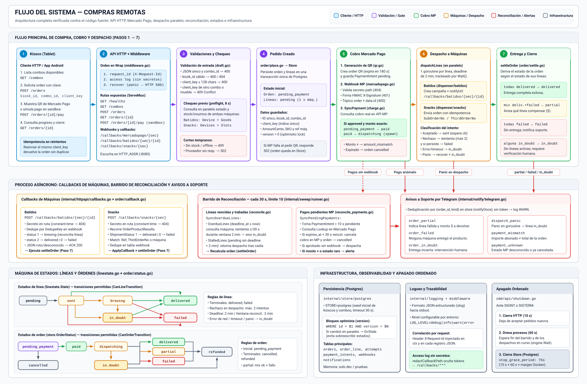

# Flujo del sistema

Diagrama del flujo con `archivo:línea` para ir directo al código; verificado contra el código el 2026-11-15; las líneas pueden moverse con cambios futuros.



## 0. Capas: quién llama a quién
```
                ┌──────────────┐        ┌───────────────────────────┐
  Tablet ──────►│ internal/    │──────► │ internal/order  (Engine)  │  ← el cerebro
  Proveedores ─►│ httpapi      │        │ place · payment · dispatch│
  (callbacks)   └──────────────┘        │ callback · reconcile ·    │
                                        │ settle · status           │
  internal/sweep (cada 30 s) ─────────► └───┬────────┬─────────┬────┘
                                            │        │         │
                            ┌───────────────▼┐  ┌────▼─────┐ ┌─▼──────────┐
                            │ internal/store │  │dispenser │ │ gate →     │
                            │ (puerto)       │  │(puerto)  │ │ preflight  │
                            └──┬──────────┬──┘  └──┬────┬──┘ └────────────┘
                         memory.go   postgres/  batidos/ snacks/
                                         │         └─ HTTP a las máquinas ─┘
                                 migrations/ + internal/migrate
  Vocabulario sin dependencias: internal/machine (Ref, Kind) · internal/linestate (State)
```
Un **puerto** es una interfaz que `order` usa sin saber quién la implementa (`store.Store`, `dispenser.Dispenser`); por eso `order` no importa ni `postgres` ni `batidos`. Patrón: *ports and adapters* (arquitectura hexagonal).

## 1. Arranque: `cmd/api/main.go`
```
main (:38)
 ├─ flags -config / -combos ............................... :38
 ├─ config.Load ........................ internal/config/config.go:95
 ├─ catalog.LoadFile → catalog.NewMemory  catalog/catalog.go:37, memory.go:14
 ├─ batidos.NewClient / snacks.NewClient  dispenser/batidos/client.go:59
 │                                        dispenser/snacks/client.go:227
 ├─ batidos.NewDispenser / snacks.NewDispenser ............ main.go:91
 ├─ openStore (:201) ── "postgres"? ─ sí → postgres.Open (postgres/postgres.go:41)
 │                                │        + Seed (postgres/seed.go:12)
 │                                └ no → store.NewMemory (store/memory.go:45)
 ├─ gate.New(preflight.New) ............ gate/gate.go:23, preflight/checker.go:68
 ├─ order.New(store, machines, notifier, gate) .... order/engine.go:48
 ├─ sweep.New(engine)  (30 s, lote 10) ............ sweep/runner.go:44
 ├─ httpapi.New + rutas en el mux ................. main.go:107, :135
 ├─ newServer (timeouts) .......................... cmd/api/server.go:16
 ├─ go sweep.Run ........ :168        go ListenAndServe ........ :176
 └─ SIGINT/SIGTERM → Shutdown 10 s y espera al barrido ......... :184
```
Aparte: `cmd/migrate/main.go:35 run` → `migrate.Apply` (`internal/migrate/migrate.go:36`); `cmd/fakeapi/main.go:22` levanta máquinas falsas (9401/9402/9403 admin).

## 2. Rutas HTTP
| Ruta | Handler | Llama a |
|---|---|---|
| `GET /healthz` | `cmd/api/main.go:137` | — |
| `GET /combos` | `httpapi/combos.go:7 listCombos` | `catalog/memory.go:40 Combos` |
| `POST /orders` | `httpapi/orders.go:10 createOrder` | `order/place.go:12 Place` |
| `GET /orders/{id}` | `httpapi/orders.go:44 readOrder` | `store.LoadOrder` |
| `POST /orders/{id}/pay` | `httpapi/orders.go:54 payOrder` | `order/payment.go:12 ConfirmPayment` |
| `POST /callbacks/batidos/{secret}/{orderId}` | `httpapi/callbacks.go:116` | `order/callback.go:55 ConfirmFromCallback` |
| `POST /callbacks/snacks/{secret}` | `httpapi/callbacks.go:155` | `order/callback.go:38 CloseFromCallback` |

## 3. Flujo de una compra, de punta a punta
```
TABLET
  │ POST /orders {combo_id, client_key, kiosk_id}
  ▼
httpapi/orders.go:10 createOrder
  ├─ decodeCreateOrder ...... httpapi/draft.go:23   (64 KB, sin campos extra)
  ├─ resolveKiosk ........... httpapi/draft.go:44
  └─ buildDraft ............. httpapi/draft.go:66   (precio SIEMPRE del catálogo)
  ▼
order/place.go:12 Place
  ├─ validateDraft :74 ──► machine.Ref.Validate (identificadores según Kind)
  ├─ ¿ya existe client_key? (:18) ── sí → devuelve la misma orden (idempotencia)
  ├─ gate.Check (gate/gate.go:27) → preflight.Check (preflight/checker.go:93)
  │     plazo total 8 s, una goroutine por máquina:
  │       checkBatidos :125  (Device + DeviceGoods)
  │       checkSnacks  :157  (Devices + Slots)
  │     no vendible → NotSellableError → 409 (httpapi/errors.go:43)
  └─ CreateOrder: orden pending_payment, líneas pending (:60)
  ▼
TABLET  POST /orders/{id}/pay   (solo env sandbox; si no, 403)
  ▼
order/payment.go:12 ConfirmPayment
  ├─ si no está pending_payment → no hace nada (:18)
  ├─ SaveOrder → paid       (ErrStale: otro /pay ganó → termina sin despachar)
  ├─ AdvanceOrder → dispatching (order/status.go:92)
  ├─ detached := context.WithoutCancel(ctx) (:47)  ← sobrevive al corte del cliente
  ├─ una goroutine por línea → dispatchWithinDeadline (order/dispatch.go:23)
  │                            con context.WithTimeout de 2 min
  └─ wg.Wait → refreshOrderStatus (order/settle.go:23)
```

## 4. El corazón: `dispatchLine` (`internal/order/dispatch.go:30`)
```
for line.Attempts < maxAttempts:
  │
  ├─ 1. RECLAMO  DeadlineAt = now+2m, ReconcileUntil = now+2m+ventana
  │      SaveLine (con versión) ── ErrStale → return (otro la tomó)
  │
  ├─ 2. AppendAttempt  clave "orden:línea:número", outcome ambiguous
  │      ErrAlreadyExists → return
  │
  ├─ 3. machine.Dispatch(...)  ──►  batidos/dispenser.go:95  o  snacks/dispenser.go:87
  │
  ├─ 4. classifyDispatch (:133)
  │       ┌──────────────────────────┬───────────┬────────────────┐
  │       │ qué pasó                 │ outcome   │ estado destino │
  │       ├──────────────────────────┼───────────┼────────────────┤
  │       │ rechazo explícito        │ rejected  │ failed         │
  │       │ error de red / timeout   │ error     │ in_doubt       │
  │       │ Accepted = true          │ accepted  │ sent           │
  │       │ no confirmó              │ error     │ in_doubt       │
  │       └──────────────────────────┴───────────┴────────────────┘
  │
  ├─ 5. SaveAttempt (cierra el intento)
  │
  ├─ 6. ¿rechazo y quedan intentos?  (:87)
  │       sí → la línea SIGUE pending, sin plazos → vuelve al for
  │       no → transitionLine al estado destino (reconcile.go:234)
  │
  ├─ 7. plazos según resultado:
  │       accepted → Ref = ProviderRef, nuevo DeadlineAt de 2 min
  │       error    → DeadlineAt = now + reconcileInterval (vuelve pronto el barrido)
  │       rejected → plazos en cero
  │       (Ref se guarda siempre que venga, aunque no se aceptó: S4r)
  │
  └─ 8. SaveLine ── ErrStale → return
```
Regla clave: solo se reintenta un **rechazo explícito**. Un error de red nunca, porque el pedido pudo llegar a la máquina; entregar dos veces es peor. Esa línea queda `in_doubt` y la resuelve la reconciliación.

## 5. Cómo se cierra una línea (dos caminos)
```
 A) CALLBACK DEL PROVEEDOR                      B) BARRIDO (cada 30 s)
 httpapi/callbacks.go:116 / :155                sweep/runner.go:65 Run → tick :79
   └ secretMatches :270 (tiempo constante;        ▼
     si falla → 404)                            order/reconcile.go:20 ReconcileDue
   ▼                                              ├─ DueLines (plazo vencido, también pending)
 order/callback.go                                │    └ reconcileLine :96 → machine.Reconcile
   ├ recordCallback :187 (webhook_event:          │        ├ resuelto → closeLine :131
   │   duplicado → 200 sin procesar)              │        └ indeterminado → extendReconcile :187
   ├ callbackLine :103                            │             (pospone o pasa a in_doubt)
   │   lineByRef :124 → lineByThirdOrderNo :138   ├─ StalledLines (pending sin plazo, pagada
   │   → lineByMachineType :152                   │    hace más de 2 min)
   ├ SNACKS  CloseFromCallback :38                │    └ resumeStalledLine :76 → dispatchWithinDeadline
   │   → applyCallback :205 (delivered/failed)    │
   └ BATIDOS ConfirmFromCallback :55              └─ settleOrder de cada orden tocada (:67)
       → markBrewing :222 + reconcileLine
         (no se confía en el aviso: se pregunta a la API)
   ▼
 settleOrder (order/settle.go:14)
```

## 6. Asentar la orden y avisar (`internal/order/settle.go`)
```
settleOrder :14
 ├─ refreshOrderStatus :23  → AdvanceOrder (status.go:92) → SaveOrder
 │                            ErrStale → recarga y reintenta UNA vez
 └─ notifyOrder :52   ¿quedó in_doubt o failed?
       └ NotificationSent? (:70) ── ya salió → nada
                                └─ no → Notify (notify/notify.go:34) → RecordNotification
                                        (primero el aviso, después el registro)
```

## 7. Máquinas de estado (`internal/order/status.go`)
```
LÍNEA (linestate)  CanLineTransition :72
  pending ──► sent ──► brewing ──┬──► delivered  (terminal)
                │                ├──► failed     (terminal)
                └────────────────┴──► in_doubt ──► delivered | failed

ORDEN (store.OrderStatus)  CanOrderTransition :49   (se deriva con DeriveOrderStatus :12)
  pending_payment ──► paid ──► dispatching ──► delivered | partial | failed | in_doubt
        └──► cancelled                     in_doubt ──► delivered | partial | failed | refunded
                                           failed | partial | delivered ──► refunded
```

## 8. Persistencia
- Puerto `internal/store/store.go:91-104`, 12 métodos: `CreateOrder`, `LoadOrder`, `OrderByClientKey`, `SaveOrder`, `SaveLine`, `AppendAttempt`, `SaveAttempt`, `RegisterWebhook`, `NotificationSent`, `RecordNotification`, `DueLines`, `StalledLines`.
- Errores `store.go:85-88`: `ErrNotFound`, `ErrAlreadyExists`, `ErrStale` (alguien escribió antes), `ErrInvalid` (viola un `CHECK`).
- `store/memory.go:32` (mutex + copias) y `store/postgres/postgres.go:31` (`WHERE version = $n`, *optimistic locking*: no bloquea al leer y detecta el choque al escribir).
- Migraciones: `0001` esquema inicial · `0002` estado `failed` de orden · `0003` `reconcile_until` · `0004` `client_key` y versión de línea · `0005` versión de orden · `0006` `notification_sent`. `internal/migrate` las aplica y vigila su huella SHA-256.

## 9. Índice rápido: «¿dónde busco…?»
| Quiero ver… | Ve a |
|---|---|
| Por qué no se vende un combo | `internal/preflight/checker.go:125` / `:157` |
| Qué pasa al pagar | `internal/order/payment.go:12` |
| Cuándo se reintenta o queda en duda | `internal/order/dispatch.go:87`, `:133` |
| Cómo se habla con batidos o snacks | `internal/dispenser/batidos/dispenser.go:95`, `snacks/dispenser.go:87` |
| Firmas de los proveedores | `batidos/sign.go:31` (MD5), `snacks/sign.go:47` (HMAC-SHA256) |
| Qué hace el barrido | `internal/order/reconcile.go:20` |
| Qué estados son válidos | `internal/order/status.go:49`, `:72` |
| Por qué no llegó un aviso | `internal/order/settle.go:52` |
| Timeouts del servidor | `cmd/api/server.go:16` |

## Diferencias con el mapa

1. `store/postgres` también importa `catalog` y `config` (en `seed.go`); el mapa no lo dice.
2. Falta `ReadHeaderTimeout` de 5 s (`cmd/api/server.go:9`) en la tabla de valores por defecto del mapa.
3. `MachineType` sigue existiendo como nombre en `internal/order/callback.go:33`, `internal/catalog/catalog.go:17` y `internal/httpapi/responses.go:27`, aunque el mapa da a entender que ya no existe.

Para consultar los invariantes y deudas abiertas, revisa [mapa-del-proyecto.md](mapa-del-proyecto.md).
